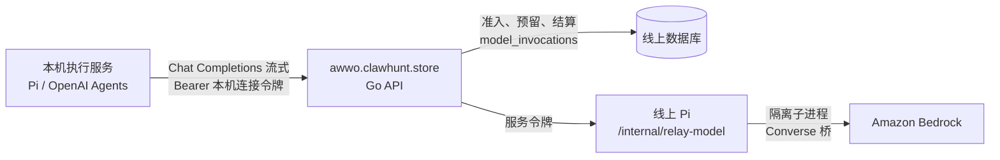

# AwwO 本地版经线上调用 Bedrock（云端中转）

状态：代码完成、已在本机模拟验证，**未上线**。线上以 `AWWO_LOCAL_RELAY=on` 打开，默认关闭；上线前需要运营方批准（见文末「上线清单」）。

运营方 2026-10-24：「必须要通过本地连接云端服务器再发送到 bedrock 连接的方案来处理」「这个不只是我这个本机，是应该所有用户都是这么交互的」。所以 AwwO 本地版（Mac 应用的本机工作区、Windows 的 AwwO Local、从代码库运行的 `npm run local`）调用 Bedrock 模型时，一律是：

本机从不持有 AWS 凭证，也从不直连 Bedrock：Bedrock 的 IAM 用户只认线上主机的地址（`docs/awwo-bedrock.md`，2026-10-19），而且费用、额度和套餐都在线上记账。本机只有一个令牌，只能经线上 API 调用模型，线上可以随时吊销它。

## 用户怎样连接（设备码）

1. 本机「我的引擎」第一张卡片「AwwO 线上」→「连接线上账号」。本机 API 向线上申请一次连接，页面显示一个八位短码（如 `KQ7M-3XHD`）和「在浏览器中打开确认页」。Mac 与 Windows 的窗口用默认浏览器打开它（`https://awwo.clawhunt.store/?link=KQ7M-3XHD`）。
2. 浏览器里登录线上账号（没登录时先走 ClawHunt 登录，短码在这个标签页里跨登录保留，与邀请链接同一做法，最长 15 分钟，与短码本身的有效期相同），在「设置 → 本机连接」看到：
   - 发起请求的设备自己报告的名字（如「AwwO 本地版 · Mac」），
   - 发起请求的网络地址和自己现在的地址；两者不是同一个网络（同一个 IPv4 地址，或同一个 IPv6 /64）时，页面提醒「如果这个确认码不是你刚刚在自己的电脑上看到的，请拒绝」，
   - 一个必须勾选的确认：「确认码 KQ7M-3XHD 就显示在我自己的电脑上，是我刚刚发起的连接」。
   然后选一个工作区，确认。**确认要求最近 15 分钟内登录过**：一个连接比批准它的网页会话长寿得多（90 天），所以很久以前的会话（例如被别人拿到的 Cookie）不能批准；页面会先请人重新登录（ClawHunt 账号同时退出 ClawHunt 主站，是一次真正的登录），回来时短码仍在。
3. 本机每 5 秒问一次线上（暂时连不上时退避重试，直到短码过期），确认后换得令牌，加密存进本机数据库（与个人 Key 同一个保险库，`AWWO_CREDENTIAL_ENCRYPTION_KEY`），再读取这个工作区可用的模型。页面显示「已连接：工作区 X，到期 YYYY-MM-DD」。线上只发一次令牌：从向线上要令牌起，换取和保存就不再依赖浏览器那次请求（关掉标签页也不丢），并且先保存连接、再读较慢的模型目录。

短码 15 分钟内有效，只能确认一次；令牌 90 天有效、只属于一个工作区。网络地址只在短码等待期间保存，一经确认或拒绝即清除，过期的短码一小时后连同地址删除。

断开与失效：

- 线上「设置 → 本机连接」列出每台连接过的电脑（名字、工作区、最近使用、到期），可以逐个断开，也可以「断开所有电脑」（`DELETE /local-links`）。电脑丢失、或在 ClawHunt 改了密码时用它：**ClawHunt 账号的密码在 ClawHunt 修改，AwwO 不会得知，连接不会随之失效**。
- AwwO 本地账号（邮箱密码登录）修改或重设密码时，会断开这个账号的所有本机连接（与「所有设备都需要重新登录」一致）。
- 成员被移出工作区、或被改成只读成员时，他对这个工作区的连接立即吊销，之后再恢复角色也不会复活；工作区被停用时，令牌在下一次调用就被拒绝；账号删除时连接随之删除。
- 本机移除「AwwO 线上」时同时吊销线上的令牌；重新连接时原地替换，两个执行引擎的连接 id 不变（选了中转模型的 Agent 不受影响），旧令牌吊销。
- 并发：确认、换令牌、断开与成员变更都先锁工作区、再锁账号、最后锁连接，与改密码、移除成员的顺序一致，不会互相等死；确认在锁住账号之后重新核对会话，在锁住成员关系之后重新核对角色，所以与改密码或降级同时发生的确认不会生效。

个人 Key 保留：「AwwO 线上」之外，「我的引擎」仍可添加 LLM Gate、OpenAI、Anthropic、xAI、Google 的个人 Key，它们照旧从本机直连各家服务。

## 能用哪些模型

`GET /api/v1/relay/v1/models` 只列出同时满足三点的模型：线上 Pi 提供的 Bedrock 模型（Pi 的 `AWWO_BEDROCK_MODELS`）；这个工作区的白名单允许（`tenants.allowed_models`，与线上画布同一规则）；本机的执行引擎用得了它（OpenAI Agents 运行要带工具，只列目录里 `tools: true` 的；Pi 运行不带工具，全部可列）。每个模型带上它在线上的真实上限：上下文预算、单次最多输出、能否看图、每 token 的字节率。本机按这些值记预算，不再套用个人 Key 的 32,768 / 4,096。

按 2026-10 的新工作区白名单，Bedrock 模型只有 Claude Opus 5.5（`bedrock.claude-opus-5-5`）；要经中转开放更多 Bedrock 模型，运营方把它们加进 Pi 的 `AWWO_BEDROCK_MODELS`，并让工作区白名单允许。LLM Gate 的模型不经中转（本机可以直接用个人 Gate Key）。

## 计费与限额

每次中转调用就是线上的一次模型调用，与线上画布的调用同一套规则，没有另立价格：

- 账本：`model_invocations` 一行（`runtime=pi`，`provider=bedrock`，`run_id = relay-<连接 id>`，新列 `relay_link_id`），按 Bedrock 回报的用量结算；被拒、被截断、取消的调用按 `plans.go` 原有规则计费或退还（`creditCharge`、`refusedBeforeOutput`、`quickRefusal`：15 秒内、且明说没到模型的拒绝不计）。结算写库失败时在后台重试几分钟；仍失败的，线上每 5 分钟把 40 分钟前还在「运行」的中转调用按重启的规则结算，不会一直占着席位和预留点数。
- 免费工作区：工作区的每日次数（`max_runs_per_day`，与生成共用）、同时运行数（`max_concurrent_runs`）、Bedrock 路由的每日额度与全站上限（`route_limits`、`AWWO_ROUTE_TOTALS_PER_DAY`），促销与签到照常加额。
- 套餐：点数（每次调用先按预估预留，结算时按实际用量扣）、同时运行的 Agent 数。中转调用没有「运行」，所以每次调用自己占一个席位：`accountSlotsUsed` 把正在进行的中转调用也算进去，画布运行和中转调用共享套餐的并发上限。
- 席位满时，中转请求最多等 60 秒，仍没有空位就答 429 `relay_busy`（带 `Retry-After`），不计费。

线上自己的保护，在工作区与套餐的限额之外：

| 限制 | 值 | 超过时 |
| --- | --- | --- |
| 每个连接同时进行的调用 | 4 | 429 `relay_busy`，读请求体之前 |
| API 同时持有的中转请求体 | 合计 64 MiB，每个账号至多 24 MiB（没有 Content-Length 的按 16 MiB 算）；从读请求体之前算起，到线上 Pi 收完它为止 | 429 `relay_busy`，读请求体之前 |
| 请求的嵌套深度 | 对象与数组至多 64 层 | 400 `invalid_request` |
| 写给本机的每一次 | 30 秒内写完（读得太慢或不再读的一端结束这次调用） | 按取消结算 |
| 单个请求体 | 16 MiB（nginx 放行 17m，让超出的请求拿到 API 的 413） | 413 `request_too_large` |
| 每个地址每分钟（IPv6 按 /64） | 申请连接 10 次、换令牌 40 次、中转调用 600 次 | 429 `rate_limited` |
| 申请连接、查看与确认短码 | 另计入登录接口的 `AWWO_AUTH_REQUESTS_PER_MINUTE` | 429 `rate_limited` |
| 全站等待中的短码 | 10,000 | 503 `link_busy` |
| 每个账号的有效连接 | 10 | 409 `link_limit` |
| 线上 Pi 同时进行的中转调用 | `AWWO_PI_RELAY_MAX_CONCURRENCY`，默认 8，与画布运行的 `AWWO_PI_MAX_CONCURRENCY` 分开 | 503 `server_busy`（不计费），满时不读请求体 |

## 协议

### 线上 API（`AWWO_LOCAL_RELAY=on`，只在线上版）

设备码（不需要登录）：

| 方法与路径（省略 /api/v1） | 输入 | 结果 |
| --- | --- | --- |
| POST /local-links/start | `{deviceName}`，1–80 个可见字符 | 201 `{deviceCode, userCode, verificationURL, expiresIn: 900, interval: 5}`；deviceCode 只此一次给出，线上只存其 SHA-256，并在等待期间记下请求的地址 |
| POST /local-links/token | `{deviceCode}` | 待确认 400 `authorization_pending`；问得比 interval 快 400 `slow_down`；拒绝 400 `access_denied`；过期、未知或已换过 400 `expired_token`；确认后 200 `{token, linkId, expiresAt, workspace:{id,name}}`，令牌只给一次 |

登录后（`awwo_session`）：

| 方法与路径 | 输入 | 结果 |
| --- | --- | --- |
| GET /local-links/pending/{userCode} | 短码，大小写和连字符不限 | 200 `{userCode, deviceName, createdAt, expiresAt, requestIP, yourIP, sameNetwork, signInAgain}`；未知或过期 404 `link_not_found` |
| POST /local-links/approve | `{userCode, tenantId, confirmed: true}` | 200 `{id, deviceName, workspace}`；没勾选确认 400 `link_unconfirmed`；会话超过 15 分钟 403 `sign_in_again`；要求在该工作区是 owner/admin/member（403 `forbidden`）且工作区正常（403 `tenant_suspended`）；每个账号最多 10 个有效连接（409 `link_limit`） |
| POST /local-links/deny | `{userCode}` | 204 |
| GET /local-links | — | `{items:[{id, status, deviceName, workspace:{id,name}, createdAt, approvedAt, lastUsedAt, expiresAt}]}`：有效的连接，以及已确认、电脑还没取走令牌的（`status: approved`，几秒内变成 `issued`；页面确认后每 5 秒读一次，最多一分钟） |
| DELETE /local-links/{id} | — | 204，吊销；只能吊销自己的 |
| DELETE /local-links | — | 204，吊销这个账号的所有连接 |

中转（`Authorization: Bearer awwo_lk_…`；带 `Origin` 的请求一律 403 `origin_not_allowed`，令牌只给服务端程序用）：

| 方法与路径 | 输入 | 结果 |
| --- | --- | --- |
| GET /relay/v1/models | — | `{object:"list", data:[{id, object:"model", owned_by:"awwo", name, awwo:{contextWindow, maxOutputTokens, input, tools, proseBytesPerToken?}}], workspace:{id,name}, expiresAt}` |
| POST /relay/v1/chat/completions | OpenAI Chat Completions，必须 `stream: true`，≤ 16 MiB | 见下 |
| DELETE /relay/v1/link | — | 204，吊销这个令牌自己；只认令牌，工作区停用或已不是成员时也能吊销 |

一次中转调用的回答：

- API 先等线上 Pi 的回答，最多 20 秒（等待窗口）。窗口内的拒绝带它自己的 HTTP 状态和 OpenAI 的错误形状 `{"error":{"message","type","code"}}`，本机的执行服务按状态识别（例如 429 是限流、400 是请求本身）。
- 流开始（或窗口过去）后答 200 `text/event-stream`：Bedrock 桥的 `chat.completion.chunk`（含最后的 usage）与 `[DONE]`；静默 15 秒发一行 `: keepalive`。之后的失败是 SSE 错误帧 `{"error":{message,type,code,status}}`，与桥自己的错误帧同形。
- 读到 `[DONE]`（在结束原因之后）或一个错误帧，这次调用就定了：本机之后才断开，也按已回报的用量结算。思考内容（`reasoning_content`）算作模型写出的内容：之后的拒绝不算「输出之前就拒绝」。
- Bedrock 桥换到模型的另一个推理配置文件（global 与 US 互为备选）之后的拒绝或错误帧，是第二次请求的：线上 Pi 随拒绝或以响应头 `x-awwo-relay-fallback: 1` 说明，API 不把它当成「没做事就被拒绝」而退还。
- API 关闭或失去数据库租约时，进行中的中转调用随运行一起停下，按重启结算（`interrupted`），API 等它们结算完才放开租约；等待准入时也一样。
- 一次调用最多先等 60 秒席位、再等 20 秒窗口，不超过 Cloudflare 允许的约 100 秒静默。

错误码：

| 状态 | code | 何时 |
| --- | --- | --- |
| 401 | `invalid_api_key` | 令牌无效、过期或已吊销 |
| 403 | `workspace_unavailable` | 不再是工作区成员（或成了只读成员），或工作区停用 |
| 400 | `model_not_allowed`、`model_unpriced` | 工作区白名单不允许；套餐下这个模型没有价格 |
| 402 | `plan_required` | 这个工作区需要拥有者的套餐 |
| 429 | `quota_exceeded`、`premium_quota_exceeded`、`premium_capacity_exceeded`、`free_capacity_exceeded`、`credits_exhausted`、`relay_busy`、`rate_limited` | 各项限额 |
| 400 | `stream_required`、`invalid_request`、`context_length_exceeded`、`invalid_request_error` | 不是流式；不是 JSON 对象或嵌套过深；超出模型上下文（消息是桥自己的「Input is too long for requested model」，本机据此识别为上下文超限）；桥不能忠实转换的请求（原样说明哪一项）；AWS 在推理之前拒绝请求本身（ValidationException，例如读不了的图片）。这些都不计次、不扣点数 |
| 404 | `model_not_found` | 不是中转提供的模型 |
| 413 / 415 | `request_too_large` / `unsupported_media_type` | 请求体过大 / 不是 JSON |
| 503 | `server_busy`、`api_error`，或 AWS 的错误类型 | 线上 Pi 满了、模型服务暂不可用。**AWS 的拒绝除限流（429）和请求本身的问题（400）之外一律答 503**，包括拒绝运营方自己的凭证、权限或额度（401/403/404）；流开始后的 401/403 错误帧也改写为 `status: 503`。本机永远不会把它当成自己的凭证失效 |
| 502 / 504 | `api_error` / `timeout` | 线上执行服务失败 / 到达时限 |

错误里从不带 AWS 原文、账号 ID 或角色 ARN。

### 线上 Pi（服务令牌，只有 API 调用）

- `/health` 增加 `relayBedrock: true`，每个 Bedrock 模型增加 `tools`（目录的 `tools`）。API 只在 Pi 这样声明时提供中转，读到的目录缓存 30 秒，读失败时 5 秒内不再重读。
- `POST /internal/relay-model`：`{relayId, tenantId, body, model}`（API 把本机的请求体原样放进 `body`，只持有一份）。`model` 必须是 Pi 自己的 Bedrock 模型；Pi 把 `body.model` 换成目录的 `target`，确保 `stream: true` 与 `stream_options.include_usage`，把 `max_tokens` / `max_completion_tokens` 压到目录上限，再在隔离子进程（`apps/pi-worker/bedrock-relay.mjs`）里经 Converse 桥调用一次（主、备推理配置文件规则不变），把桥的 SSE 原样流回。凭证由父进程解析、经私有 IPC 交给子进程，子进程只带 `workerEnvironment` 的变量。
- 单次时限 `AWWO_PI_RELAY_TIMEOUT_MS`（默认 1,500,000，即 25 分钟，与 Python worker 的节点时限相同）。中转有自己的并发池 `AWWO_PI_RELAY_MAX_CONCURRENCY`（默认 8），与画布运行的 `AWWO_PI_MAX_CONCURRENCY` 分开：再多电脑经线上调用，线上自己的运行也有席位；池满时不读请求体就拒绝。

### 本机（`AWWO_EDITION=local`）

- 运行时给 API 与执行服务 `AWWO_CLOUD_ORIGIN`（默认 `https://awwo.clawhunt.store`，`local.env` 可以改或设为 `off`）。它必须恰好是一个源：https、主机名由 ASCII 字母数字和中间的连字符组成、端口 1–65535；或测试用的 `http://127.0.0.1:<端口>`。API（Go）、执行服务（TypeScript、Python）与运行时脚本用同一条规则，共用 `apps/cloud-origin-vectors.json` 的用例。执行服务据此只接受 `${AWWO_CLOUD_ORIGIN}/api/v1/relay/v1` 这一个中转地址：用户输入从不提供网络地址，这条规则不变。
- 本机 API：`POST /auth/cloud-link`（开始，返回短码与确认页地址）、`POST /auth/cloud-link/poll`（问一次；两个标签页同时问也只问线上一次；确认后建立连接；令牌在路上时连接被取消或重新开始，这个令牌不保存、在线上吊销，答 `cancelled`）、`DELETE /auth/cloud-link`（放弃）。「AwwO 线上」的连接按执行引擎各存一行（Pi 与 OpenAI Agents，同一个令牌），新列 `user_connections.relay` 记发令牌的线上源、连接 id、工作区、到期与每个模型的上限。令牌只发往记下的那个源：`AWWO_CLOUD_ORIGIN` 改了以后，旧连接不再提供模型、「刷新模型」答 409 `cloud_origin_changed`，需要移除后重新连接；移除时向原来的源吊销令牌。`POST /auth/connections` 不接受 `awwo`（只能经设备码连接）。
- 执行服务（Pi、OpenAI Agents JS、Python）：`bindUserModel` 接受 `provider: "awwo"` 的个人模型，带它自己的上下文、最大输出和图片能力；直接执行（托管执行）对中转与 LLM Gate 一样以流式发出、收拢成一次回答（`computer-model.ts`）。

## 安全

- 令牌 `awwo_lk_` + 32 字节随机数，线上只存 SHA-256；本机加密存放，只交给执行服务用于当次调用。设备码同样只存哈希。
- 设备码钓鱼（别人在自己电脑上发起连接，把确认链接发给你）：确认页显示设备自报的名字、发起请求的网络与你现在的网络并在不同时提醒，必须勾选「确认码就显示在我自己的电脑上」，并要求最近 15 分钟内登录过（RFC 8628 §5.4 的做法）。
- 中转拒绝带 `Origin` 的请求（浏览器拿不到令牌，也不能借用它）；不回 CORS 头。
- 只转发桥能忠实转换的请求；桥拒绝的字段原样 400，不静默丢弃（`docs/awwo-bedrock.md`）。
- 日志只记连接 id、工作区、模型、状态与字节数，从不记提示词、回答或令牌；网络地址只在短码等待期间保存。

## 上线清单（需要运营方批准）

1. 部署包含本变更的 API（迁移 042：`local_links` 表、`model_invocations.relay_link_id`、`user_connections.relay`，均为新增，不改写旧行）、网页与 Pi worker；先 API 后 Pi，开关保持关闭。
2. nginx：`deploy/saas/nginx.conf` 已为 `= /api/v1/relay/v1/chat/completions` 单独一个 location（`client_max_body_size 17m`、缓冲请求体、`proxy_buffering off`、`proxy_read_timeout 660s`），用部署镜像 nginx 1.28.0 `nginx -t` 通过；主机上若另有一层 nginx（`nginx-web.conf`），要同样放行 17m。
3. Cloudflare：确认 `/api/v1/relay/` 与 `/api/v1/local-links/` 对非浏览器请求可达：`curl -s -o /dev/null -w '%{http_code}' https://awwo.clawhunt.store/api/v1/relay/v1/models` 应得 API 自己的 401，而不是 Access 的 302/403。若仍被 Access 拦，为这两个路径各建一个 Bypass 的 Access 应用（鉴权由 API 的令牌负责）。
4. Pi 的环境：确认 `AWWO_BEDROCK_MODELS` 含要开放的模型（至少 `bedrock.claude-opus-5-5`），价格表 `AWWO_MODEL_PRICING_JSON` 有 `pi:<模型>` 的价格（套餐工作区按它扣点数）；按主机内存定 `AWWO_PI_RELAY_MAX_CONCURRENCY`（每次中转调用一个 Node 子进程，约 50–80 MB）。
5. API 的环境：先确认 `AWWO_TRUSTED_PROXY_CIDRS` 让 API 看到真实的客户端地址（只读查看主机上的设置）：每个地址的限额和确认页显示的网络地址都靠它，为空时所有请求都算作 nginx 这一个地址，全站每分钟只能申请 10 次连接、发起 600 次中转调用。然后 `AWWO_LOCAL_RELAY=on`，重启 API。读回 Pi 的 `/health`：`relayBedrock: true`；在确认页看「你现在的网络」是不是自己的公网地址。
6. 冒烟：用一个测试工作区连接一台本地版，跑一个 Opus 5.5 节点；查 `model_invocations` 里 `relay_link_id` 的那一行（用量、扣费）、线上「本机连接」的「最近使用」，再断开，确认本机下一次调用得到 401。
7. 发布带 `AWWO_CLOUD_ORIGIN` 的本地版：Mac 应用 build 12（重新组装 payload）与 Windows AwwO Local 0.1.2。

回滚：`AWWO_LOCAL_RELAY` 改回 off 并重启 API，所有中转与连接接口即消失（本机显示「线上暂不可用」，个人 Key 不受影响）；迁移只新增，不需要回滚。
