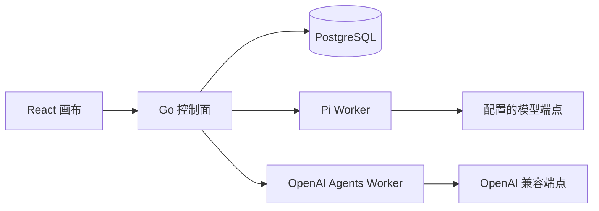

# AwwO OpenAI Agents JS 运行时

状态：本地实现候选；基线 `e05d2afd29700b07b918193432b4ba18ad6dd5ec`。合并、远端推送和生产部署分别验收，不能由本文件推定。

## 目标与边界

AwwO 在保留 Pi 的同时增加可选 `openai-agents` 执行框架。Go 继续负责登录、租户权限、画布版本、Agent/Session 身份、团队编排、配额、审计、取消和持久化。官方 `@openai/agents` JavaScript SDK 只执行 Go 已受理的一次成员调用，不接管 AwwO 的团队顺序或成员间关系。



这意味着顺序、并行、讨论和审核模式都由同一套 Go 编排器决定。每位成员的 `runtime`、模型、专属指令、上下文和工具在受理时冻结；成员 runtime 留空时继承团队 runtime。Go 将该成员的专属指令作为 `systemPrompt` 发给对应 worker，不依赖 SDK 自动 handoff，因此不会跳过前序成员或把后一位成员的指令覆盖前一位。

## 运行时与模型目录

公开标识固定为 `pi` 和 `openai-agents`。`GET /api/v1/tenants/{tenantId}/runtime` 保留 Pi 的兼容字段，并增加：

```json
{
  "runtimes": [
    {
      "id": "openai-agents",
      "name": "OpenAI Agents",
      "configured": true,
      "available": true,
      "supportsEffortSelection": true,
      "effortInputMode": "select",
      "tools": ["calculator"]
    }
  ],
  "models": [
    { "id": "model-id", "provider": "openai", "runtime": "openai-agents", "reasoningEfforts": ["low", "medium", "high"], "defaultReasoningEffort": "medium" }
  ]
}
```

前端按 runtime 过滤模型，切换 runtime 时清空旧模型和工具，防止把 Pi 模型 ID 发给 OpenAI Agents worker。不可用的旧配置会保留显示并要求修正，不会静默回退。Agent 的 runtime 写入 `agents.runtime`；迁移 011 将历史 Agent 设为 `pi`。已初始化节点切换 runtime 会创建新的 Agent/Session，保留旧历史，不把不同 SDK 的会话混在一起。

## 思考强度（reasoning effort）

思考强度与模型是平行的 Agent 字段，并且按模型发布，而不是按 runtime 发布：

- Worker 在 `/health` 的每个模型上发布 `reasoningEfforts` 与 `defaultReasoningEffort`。没有发布档位的模型不接受任何显式档位；Pi 目前不发布档位。
- Go 在探测 worker 时校验档位格式、是否重复，以及默认档位是否属于档位集合；任一不满足即整份目录无效。运行时目录的 `supportsEffortSelection` 仅在该 runtime 至少一个模型发布了档位时为 true，`effortInputMode` 固定为 `select`，前端只提供所选模型自己的档位。
- 节点初始化、团队成员解析和运行准入都按所选模型校验档位，不支持时返回 `400 invalid_node_setup`，不会静默丢弃。档位写入 `agents.effort`（迁移 016，默认空字符串），冻结进执行快照，并作为请求字段 `effort` 转发。只修改档位也会建立新的 Agent 与当前会话。团队成员留空模型而继承节点模型时，一并继承节点的思考强度；成员指定自己的模型时只使用成员自己的档位。
- Worker 再次校验：请求档位不在所选模型档位中时返回 `400 EFFORT_NOT_SUPPORTED`；通过后写入 SDK `modelSettings.reasoning.effort`。未指定档位时请求不携带任何思考设置，由供应商使用自身默认；`defaultReasoningEffort` 只用于展示，永不回填。
- OpenAI 兼容端点是否真正支持某个档位，需要按实际端点和模型验证后再配置。未配置档位时，行为与此前完全一致。

## 私有 Worker 契约

服务位于 `apps/openai-agents-worker`，默认只监听 `127.0.0.1:8098`。Go 使用独立的 `AWWO_OPENAI_AGENTS_URL` 和 `AWWO_OPENAI_AGENTS_TOKEN`。模型 base URL、API key 和额外目录仅存在 worker 服务环境中，不进入浏览器、画布 JSON、Go 执行快照、日志或命令行参数。

接口与 Pi worker 对齐：

- `GET /health`：只返回 SDK 版本、配置状态、公开模型、限制和已启用工具；不探测真实模型。每个模型条目的展示名取 profile 可选的 `name`，未设置时仍是供应商模型 ID；只有启用结构化交付输出的 profile 才带 `structuredOutput: true`，未启用时该键不出现，目录字节不变。
- `POST /internal/runs`：内部 bearer token 认证，接收固定的 run/tenant/session 身份、prompt、history、systemPrompt、runtime、model、可选 effort、可选 `outputContract` 和工具名称，返回 SSE。
- `DELETE /internal/runs/{runId}`：精确取消一个成员调用。

每次调用在独立 Node 子进程和临时目录中运行。子进程只通过私有 IPC 接收所选模型凭据及已验证输入；不继承 HOME、代理、NODE_OPTIONS、父进程凭据或用户配置。SDK tracing 和敏感模型日志关闭。进程边界不能替代容器或操作系统沙箱，公网部署仍使用只读文件系统、非 root 用户、capability drop、进程/内存上限及受控出网。

## 单次调用与配额语义

一次 AwwO 成员 turn 最多产生一次上游模型请求：SDK `maxTurns: 1`、`stop_on_first_tool`、客户端零重试，并有额外调用次数守卫。普通回复直接返回模型文本；模型选择工具时，经过校验的工具结果直接成为该成员输出，不再调用模型总结。因此 `model_invocations` 的一条准入记录对应至多一次上游请求，团队 `maxTurns` 仍表示最多模型调用次数。

将来若启用多轮工具循环，只允许下文「会话历史归属」规定的 Go 驱动循环（架构 B）：每次模型调用先经 Go 准入，再发起一次独立的 worker 调用，并建立可恢复的调用身份。不能调高 SDK 的 `maxTurns`，也不能在 worker 内循环并通过准入回调向 Go 申请额度。

## 会话历史归属

Go 是会话历史的唯一事实源。Worker 不保存、不读取、也不补全历史，子进程及其临时目录在调用结束后删除，不留下任何会话状态。每次调用中唯一的对话内容是 Go 在请求 `messages` 中给出的消息加上本次 `prompt`。请求另外只携带本次调用自己的系统指令（请求中的 `systemPrompt`，未提供时为 worker 固定的默认指令）、经准入的工具定义，以及请求设置（如 `store: false`、输出上限、可选的推理强度），从不包含更早调用的历史、输出或响应 id。因此同一租户、同一 Session 的下一次调用若 `messages` 为空，上游请求中唯一的对话轮次就是它自己的 prompt。

历史在 Go 中的读取时点因路径而异：

- 团队运行（普通运行或画布图中的团队节点）在受理事务中读取本 Session 已完成的问答对并冻结进执行快照。只有 `shared` 上下文的成员会收到历史，并按自己的模型预算截取，不再重新读取；每位成员实际发送的 `messages` 和上下文审计写入 `run_turns`。
- 画布图的单 Agent 节点在图受理事务中读取并截取本 Session 已完成的消息，冻结进节点执行快照。协作轮次在创建子运行时再追加该节点已完成协作轮次的消息，结果随子运行快照一起保存。
- 非团队的单次运行在 `reserveInvocation` 预留调用额度之后才实时读取 `messages` 表。读取结果既不写入快照，也不进入审计，事后无法还原当时实际发送的历史。这是已知缺口，尚未修复（后续待办：在准入时冻结并审计单次运行历史，与团队和画布图路径一致）。`planner` 类调用始终发送空历史。

Worker 侧必须保持的不变量：

- 从不使用 SDK Session（包括 `MemorySession`、`OpenAIConversationsSession`、`OpenAIResponsesCompactionSession`）、`previousResponseId`、`conversationId`、`sessionInputCallback`、`setDefaultOpenAIClient`、`setDefaultOpenAIKey`、`run_llm_again` 或 `responses.compact`。请求固定 `store: false`，不携带 `previous_response_id` 或 `conversation`；每次调用在子进程内新建一个 OpenAI 客户端并显式交给 SDK 模型，凭据只来自 IPC 传入的模型配置。
- `agent-runtime.mjs` 只有一处 `runner.run(...)`，选项固定为 `{ stream: true, signal, maxTurns: 1 }`，该文件中不出现其他 `run` 标识符。Agent 固定 `toolUseBehavior: 'stop_on_first_tool'`；SDK 的默认值就是 `run_llm_again`，所以这一设置不能省略。
- `agent-runtime.mjs` 的 fetch 守卫只放行所选协议的精确端点（`<baseURL>/chat/completions` 或 `<baseURL>/responses`），转发时禁止重定向；其他 URL（包括端点加路径段、尾部斜杠或查询参数）在发出前即被拒绝，本次调用失败。这道守卫只覆盖 `agent-runtime.mjs` 创建的那一个客户端，是第二道防线。SDK 的压缩会话通过 `responses.compact` 请求 `<baseURL>/responses/compact`，它选择客户端的顺序是显式传入的客户端、默认客户端、`new OpenAI()`，后两者都不经过这道守卫。阻止此类未经 Go 受理的调用的首要保障是第一条不变量（不使用 SDK Session、不设置默认客户端、不调用 `responses.compact`）；此外子进程环境不含 `OPENAI_API_KEY`，`new OpenAI()` 兜底会因缺少凭据而抛错。放宽守卫或新增端点之前，必须先为新端点建立 Go 准入和台账。

后续扩展必须遵守：

- 若需要总结或压缩历史，必须作为一次独立调用，经 Go 受理并写入 `model_invocations` 台账；不得在成员调用内部由 SDK 或 worker 顺带发起。目前没有任何历史总结功能。
- 需要多次模型调用的工具使用只允许 Go 驱动的循环（架构 B）：每次经 Go 受理的模型调用对应一次独立的 worker `POST /internal/runs`；Go 先结算第 k 次调用，再为第 k+1 次预留额度；续接内容（工具调用及其结果）由 Go 校验并规范化后，作为下一次请求的输入。被否决的备选方案是在 worker 内运行 SDK 多轮循环、再通过准入回调向 Go 申请额度，禁止采用。目前尚未实现多轮工具循环，现行行为仍是上一节的单次调用语义。

`apps/openai-agents-worker/history-boundary.test.mjs` 固定上述不变量：

- 行为测试：对 Chat Completions 与 Responses 各做两次同一租户、同一 Session 的调用，证明第二次请求除自身系统指令外唯一的对话轮次就是它自己的 prompt，不含第一次调用的历史、输出、提供方 id 或续接字段，且只请求精确端点、`store` 为 `false`。
- 守卫测试：在测试进程内执行一次调用，取得 worker 交给 OpenAI 客户端的受守卫 fetch 并直接调用，证明只有精确端点会被转发且带 `redirect: 'error'`；`/responses/compact`、端点加路径段、尾部斜杠、查询参数、另一协议的端点，以及其他主机、端口或协议，都在发出前以 `MODEL_REQUEST_REJECTED` 被拒绝。
- 静态扫描：遍历 worker 目录（含子目录，跳过 `node_modules` 和点目录）下所有非测试模块，查找上述禁用项和各种 `run` 调用写法（成员访问 `.run`、直接调用 `run(`、计算属性 `['run']`、导入或解构 `run`），要求所有模块合计只有 `agent-runtime.mjs` 中那一处 `runner.run`；并检查该调用的选项、该文件中 `run` 标识符只出现一次，以及 `toolUseBehavior` 只设为 `'stop_on_first_tool'`。
- 静态扫描按源码文本匹配（包括注释），识别不了经变量或拼接字符串间接取得的调用；运行时的模型调用次数守卫（`MODEL_CALL_LIMIT`）是另一道防线。

## 结构化交付输出

默认关闭。只有 profile 显式 `structuredOutput: true`（默认模型用 `AWWO_OPENAI_AGENTS_STRUCTURED_OUTPUT=true`）才具备该能力，它断言这个端点与模型在所配协议上接受 `json_schema` 响应格式，并把推理放在正文之外。启用前必须在 staging 用一个双字段契约和一个单文本字段契约各跑通一次裸 JSON 交付，且那次运行**确实冻结并发送了契约**（staging API 同时打开 `AWWO_STRUCTURED_DELIVERY_CONTRACTS`，见下文「灰度与回滚顺序」）。

Go 从节点冻结的输出字段派生 `outputContract`，worker 永不接受 schema 文本。语法是封闭的：`{version:1, fields:[{id, type, required}]}`，1–32 个字段、最多 8 个 `file`、ID 唯一且匹配 `^[A-Za-z0-9_-]{1,64}$`（排除 `__proto__`、`prototype`、`constructor`），`type` 取 `text`、`markdown`、`html`、`number`、`boolean`、`file` 之一，`required` 为布尔。其他键或取值一律 `INVALID_INPUT`。ID 判定向量与 Go 共用 `backend/internal/app/testdata/output_contract_v1_vectors.json`。

- worker 只按契约生成固定 schema：文本三类映射为 string，`number` 与 `boolean` 各自对应，`file` 是恰好 `name` 与 `content` 两个 string 的对象；属性顺序照契约，每层 `additionalProperties: false`，不带任何描述文字。仅当所有字段都必填时才请求 strict 解码，因为 strict 供应商会拒绝可选属性。Chat Completions 作为 `response_format`，Responses 作为 `text.format`。
- 准入把响应格式外壳的字节计入同一条上下文预算；该语法允许的最大外壳是 6,063 字节，仍在 Go 的 8,192 字节预留内。
- 契约与非空 `tools` 互斥（`INVALID_INPUT`）：被选中的工具结果本身就会成为成员输出，绕过契约。不具备该能力的 profile 在占用任何会话、并发额度或子进程之前就以 `OUTPUT_CONTRACT_NOT_SUPPORTED` 拒绝，runner 再校验一次。
- 回复必须是恰好一条只含文本片段的助手消息，且该文本是一个 JSON 对象：不接受 Markdown 围栏、散文或数组。随后由一个本地纯函数输出护栏做结构检查：未声明字段、必填字段缺失或为 null、JSON 类型不符、`file` 不是 `{name, content}` 字符串对、或一个声明字段都没交付。护栏的诊断只写违规类型，绝不带交付内容。
- 上述任一失败（含空回复或只含推理的回复）都以 `OUTPUT_CONTRACT_INVALID` 终止本次成员 turn。不配置任何 SDK 错误处理器、拦截消息、修复、重试或第二次模型调用，因此「一次成员 turn 至多一次上游请求」不变。`completed` 的 `text` 就是交付的原始字节，Go 仍按自己的取值规则（空白文本、完整 HTML、文件名、大小与数量）再校验一遍。
- 不带 `outputContract` 的请求不发送任何响应格式，在所有 profile 上的行为与此前完全一致。

### 冻结规则（Go 侧）

契约在**图受理事务内**冻结进节点执行快照，判据是四条同时成立：API 开启了部署开关 `AWWO_STRUCTURED_DELIVERY_CONTRACTS=true`、节点**不是团队节点**（`Team == nil`）、runtime 为 `openai-agents`、且**该节点自己选的模型**在 worker 目录里声明了 `structuredOutput`。任何一条不成立就只发文字策略、不带 `outputContract` 键（不是 `null`、也不是空对象）。**worker 能力本身不冻结任何契约**，开关默认关闭。

- **模型级、精确匹配**：`supportsStructuredOutput` 只认完全相同的模型 ID；目录里查不到的 ID 一律视为不具备该能力。能力只接受字面量 `true`：非 `openai-agents` 的 worker 声明了 `true`（原因 `wrong_runtime`），或取值不是 `true` / `false` / `null`（如字符串 `"true"`、数字，原因 `malformed`），探测时清除该能力，而不是整份目录失败；`false` 与 `null` 就是「关闭」，不记录。清除只在整份目录通过校验后才记录：每个 runtime / 模型 / 原因记一条 `runtime capability cleared` 警告日志（与是否开启指标无关，最多 512 个不同键，超出后只再提示一次），开启 `AWWO_METRICS_ENABLED` 时每次清除还计入 `awwo_runtime_capabilities_cleared_total{runtime,capability="structured_output",reason="wrong_runtime"|"malformed"}`。`awwo_graph_output_contracts_total` 同样只在开启指标时计数。
- **撤回纯文本许可**：单个 text/markdown/html 输出字段的文字策略原本允许「整段值直接以纯文本返回」。冻结了契约时，这句许可从指令和节点 prompt 最后一个 `【输出格式】` 策略块（含协作 proposal / synthesis 的种子）里替换为「只返回 JSON 对象」，因为供应商此时强制 JSON schema；输入值、帮助文字和协作目标都在该块之前，原样送达，即使它们引用了这句话。两处的时点不同：指令那句在**每次发送时派生**，不写进快照；节点 prompt 的替换发生在**受理子运行时**，替换后的文本写入 `runs.prompt`、`request_hash` 和该 session 的用户消息，因此会作为历史出现在同一节点 session 的后续运行里（包括回滚后不带契约的运行）。未冻结契约的请求一字不变。
- **团队排除**：团队成员通过自己的 turn 交付进节点信封，成员调用一律不带契约。
- **协作评议排除**：`review` 阶段在受理该 turn 时清除契约（`proposal` / `synthesis` 保留）—— 批评是讨论而非交付物，一边要求 Markdown 一边强制 JSON schema 会让每个评议 turn 失败。
- **越界回退**：节点字段落在语法之外（ID 非法 / 重复 / 类型未知 / 超过 32 字段或 8 个 file）时**回退为只发文字策略**，并记一次 `awwo_graph_output_contracts_total{outcome="fallback_bounds"}`；绝不发一份被裁窄的 schema 去静默丢字段。
- **快照即事实**：契约随快照冻结。API 重启时，普通 DAG 图里尚未派发的等待节点按快照派发；重启那一刻已排队或运行中的运行被标为 `interrupted`，不重放。协作图不同：一个 turn 被中断就结束整张协作图——所有节点标为 `failed`，其余待办 turn 取消，后续 proposal / synthesis 不再按冻结的契约派发。执行前（**在预留配额之前**，也在团队分支之前）会重新校验一致性，快照的契约若与其团队 / runtime / 模型 / 语法矛盾，该运行以 `snapshot_invalid` 失败且**不留任何 invocation 台账行**。
  该校验读的是**快照自带的目录**，因此它拦的是「快照自身矛盾」——手工改过的行、契约与团队 / runtime / 模型 / 语法不符。**受理之后**才在 worker 侧被撤销的能力不由它发现：worker 以 HTTP 400 `OUTPUT_CONTRACT_NOT_SUPPORTED` 拒绝该请求，但 Go 不读取准入拒绝的响应体，运行与节点记录的是通用的 **`runtime_rejected`**（前端显示通用的运行时配置提示），不会出现 `OUTPUT_CONTRACT_NOT_SUPPORTED`。运行失败但绝不会交付格式错误的结果；两条路径都是 fail-closed。
- 失败区分：worker 报 `OUTPUT_CONTRACT_INVALID` 时，**仅当本次运行确实带了契约**才记为 `output_contract_invalid`，否则仍是通用的 `runtime_failed`。Go 自己的取值校验（空白文本、完整 HTML、文件名/大小/数量）失败属于节点校验失败，模型确实交付过，因此那条 invocation 仍是 completed。

### 预算不变量

响应格式外壳按 **8,192 字节**预留（`schemaReserveBytes`，与 worker 的 `CONTRACT_LIMITS.schemaBytes` 一致，实际最大外壳 6,063 字节）。该预留在三处都计入：图受理时的历史裁剪、受理时的 `context_limit` 判定、以及分发时的历史裁剪。**没有冻结契约时这三项都加 0，且指令字符串一字不变**。请求 golden（`backend/internal/app/testdata/golden`）逐字节固定的是它们所刻画的小历史请求，并断言未配置时没有任何快照带 `outputContract` 或 `structuredOutput` 键；它们的历史远离预算边界，**不覆盖裁剪边界**。「无契约时预留为 0」由 `structured_output_test.go` 的纯函数测试和 `TestPostgresGraphStructuredOutputReserveTrimsHistory` 的无能力分支固定。文字策略里追加的那句 schema 说明也是**发送时派生**，不写进快照。

### 目录可见性与命名建议

运行时目录（`GET /api/v1/tenants/{tenantId}/runtime`）**不透出** `structuredOutput`，前端也没有对应徽标；能力只在 worker `/health` 与 Go 内部可见。因此要让人能在选择器里分辨，靠 profile 的展示 `name`：为同一上游模型另起一个 profile 并给它一个显式 `name`（最多 80 字符，长模型 ID 用短标签）。

- **profile ID 规则**：`id` 必须匹配 `^[A-Za-z0-9][A-Za-z0-9_.-]{0,127}$`，不能含 `/` 或 `:`。不要直接粘贴上游模型 ID——把不允许的字符换成 `-` 并控制在 128 字符内，例如 `vendor/model:tag` → `vendor-model-tag-structured`；真实上游模型 ID 只放在 `model`。不合规的 ID 会让整个 worker 启动失败，连同它的非结构化模型一起下线。
- **影响范围**：只有**选了该 profile 的节点**会冻结契约，所以单独 profile 就是按节点的灰度。反之，`AWWO_OPENAI_AGENTS_STRUCTURED_OUTPUT=true` 让**默认模型**具备能力，开关打开后所有用默认模型的 `openai-agents` 单 agent 节点都会冻结契约，不适合灰度。
- **allowlist 不是开关**：`allowed_models` 为 NULL 的工作区（当前所有既有工作区）本来就能看到并选择目录里的每个模型，不存在可以增删的条目。受限工作区里把 profile 移出 allowlist，会让仍在 `waiting` 的图节点（受理子运行时重新按 allowlist 盖章）和排队中的运行（预留配额时）以 `model_not_allowed` **失败**，而不是平稳排空。灰度与回滚一律用 API 开关。

### 灰度与回滚顺序

启用：

1. 先在 **staging** 完整走一遍下面第 2、3 步，再用一个双字段契约和一个单文本字段契约各跑通一次裸 JSON 交付。只有**确实冻结并发送了契约**的运行才算验收：该节点的 `graph_run_nodes.execution_snapshot ? 'outputContract'`（或其 `runs.execution_snapshot ? 'outputContract'`）为真，或开启指标时 `awwo_graph_output_contracts_total{outcome="frozen"}` 增加。`fallback_bounds` 或快照里没有契约的运行不算——它们只走文字策略，验证不到 json_schema、strict 解码、worker 护栏和撤回的纯文本许可。
2. 给 worker 加上带 `structuredOutput: true` 的 profile 并重启 worker。此时只多了能力，不冻结任何契约，请求与此前一致。
3. 在 API 设置 `AWWO_STRUCTURED_DELIVERY_CONTRACTS=true` 并重启 API。之后受理的图，凡节点选的是该 profile，才冻结契约。

开关只在 API 启动时读取。**任何一次 API 重启**都会把所有工作区中已排队或运行中的运行标为 `interrupted`：普通 DAG 图里这些运行所在的节点失败、等待它们的下游节点变为 `blocked`，协作图则整张失败并取消余下 turn。**worker 重启同样取消该 worker 上所有 profile 的在途运行**（worker 关闭时会取消每个活动运行），所以第 2 步和回滚第 3 步的 worker 重启与 API 重启一样要放在低峰时段。

**回滚必须先关开关、再排空、最后撤能力**：

1. 在 API 设置 `AWWO_STRUCTURED_DELIVERY_CONTRACTS=false`（或删除）并重启 API（重启的影响同上）。新受理的图不再冻结契约；重启后仍在等待、尚未派发的节点照常按冻结的契约派发，因为一致性校验读的是快照自带的目录，worker 仍具备能力。不改任何工作区 allowlist。
2. 等在途契约排空——**两条查询都必须归零**：

```sql
-- 已创建的运行（queued / running）
SELECT count(*) FROM runs
 WHERE status IN ('queued','running')
   AND execution_snapshot ? 'outputContract';

-- 尚未派发的图节点：契约先冻结在节点快照里，此时可能还没有 runs 行
SELECT count(*) FROM graph_run_nodes
 WHERE state IN ('waiting','running')
   AND execution_snapshot ? 'outputContract';
```

只查 `runs` 会漏掉仍在 `waiting` 的下游节点 —— 它们的契约在图受理时就已冻结，但运行要等上游完成才创建。

3. 两者归零后再把该 profile 的 `structuredOutput` 置回 false 并重启 worker。**不要顺手移除 profile**：上面两条查询只数带契约的快照，不带契约但选了该 profile 的等待节点和排队运行仍在它们冻结的目录里带着这个模型 ID，profile 一旦消失就会在 worker 准入时被以 `MODEL_NOT_FOUND` 拒绝（记为 `runtime_rejected`），绑定它的 Agent 之后的受理也会以 `model_unavailable` 失败。要下线一个 profile，先把 Agent 改绑到别的模型，再按 `execution_snapshot->>'model'` 等于该 profile ID 对两张表各排空一次。

反向操作（先撤能力、后排空）会让那些运行在 worker 准入时被拒，记为 `runtime_rejected`（不是 `snapshot_invalid`）；它们是 fail-closed 的失败，不会交付错误格式的结果，但属于可避免的失败。

### 个人凭据模式与托管部署的现状

- `AWWO_CREDENTIAL_MODE=user`（个人凭据模式，Compose 与 `awwo.clawhunt.store` 当前都是）下，Go 的运行时目录来自每个用户的 `user_connections`。某个连接的条目只有在以下三点**同时**成立时才声明 `structuredOutput`（`personalRuntime`，`connections.go`）：
  1. API 开关 `AWWO_STRUCTURED_DELIVERY_CONTRACTS=true`；
  2. 当前被 API 调用的 worker 在个人凭据模式的 `/health` 里声明 `userStructuredOutput: true`，即它能绑定带 `structuredOutput` 的用户模型。JS worker（`apps/openai-agents-worker`，本版起）只在个人凭据模式下声明；Python worker 与更早的 JS 构建不声明。只认字面量 `true`，其他取值按畸形处理，记一次能力清除（`runtime_capabilities_cleared_total{reason="malformed"}`），不会让 runtime 不可用；
  3. 供应商具备能力：`providerStructuredOutput(provider, protocol)` **按供应商判定**而不是按模型名，本版只有 `openai` 供应商（`api.openai.com`，`responses` 与 `chat_completions` 两种协议）在 `openai-agents` runtime 上成立；`llmgate` / `google` / `xai` / `anthropic` 一律不成立（网关与兼容层未在严格 schema 上验证过，fail-closed）。
  该字段 `omitempty`，运行时目录接口也不透出它，而每个执行快照都会冻结调用者的整份目录，所以开关关闭、或 worker 不声明时，目录、快照、请求与 ledger 的字节都与此前完全一致。
- **冻结仍由上面三点共同决定**：`AWWO_STRUCTURED_DELIVERY_CONTRACTS` 关闭时，OpenAI 连接上的节点与此前完全一样——不冻结、不发送契约，`userModel` 仍是原来的 10 个字段。开关打开、但 API 指向不声明能力的 worker（例如现在托管部署用的 Python worker）时同样如此：开关保持惰性，节点照常按文本运行，不会被 worker 在准入时拒绝。开关打开且 worker 声明能力后，选了 OpenAI 连接的 `openai-agents` 单 agent 节点按上文「冻结规则」冻结契约；`personalAdmission` **仅在该次请求已带 `outputContract` 键、且该连接的供应商具备能力时**才在 `userModel` 里追加第 11 个字段 `structuredOutput: true`，worker 的 `bindUserModel` 只接受字面量 `true`、且只在 `openai-agents` runtime 上接受，再由 `authorizeOutputContract` 放行契约。其他供应商的连接在开关打开时也不冻结任何契约，仍发送 10 字段的 `userModel`。这条路径无需数据库迁移，默认关闭。
- 托管部署目前把 `AWWO_OPENAI_AGENTS_URL` 指向 `apps/openai-agents-python-worker`（Python SDK worker，`:8099`），而不是本文描述的 `apps/openai-agents-worker`（JS SDK worker，`:8098`，仍在运行但未被 API 调用）。Python worker 不实现 `outputContract`，也不在 `/health` 声明 `userStructuredOutput`，所以即使打开开关也不会冻结任何契约；本文的结构化交付、单次调用守卫等 worker 侧行为只在 API 指向 JS worker 时成立。已冻结契约的节点在把 API 改回 Python worker 之前，应按上文的排空步骤处理完。

## 安全工具

首版只有两个内置只读函数：

| ID | 输入 | 输出 |
| --- | --- | --- |
| `calculator` | 受限算术表达式 | 有界数字 JSON；自建解析器，不使用 `eval` |
| `current_time` | 可选 IANA 时区 | UTC ISO 与本地化时间 JSON |

工具需要同时出现在服务端 `AWWO_OPENAI_AGENTS_TOOLS_JSON` 和成员请求中。浏览器只能选择 worker health 已发布的固定 ID，不能提供代码、URL、schema 或 MCP 服务。畸形 JSON、额外字段、重复或未知工具、多工具调用都会明确失败。首版不开放 shell、文件、浏览器、任意网络函数、托管工具、handoff 或租户自定义 MCP。

## 配置

三个环境使用同一变量名，不共享秘密或资源：

- Go：`AWWO_OPENAI_AGENTS_URL`、`AWWO_OPENAI_AGENTS_TOKEN`；结构化交付契约的部署开关 `AWWO_STRUCTURED_DELIVERY_CONTRACTS`，只接受 `true` / `false`，留空等于 `false`，其他取值直接终止启动。
- Worker 默认模型：`AWWO_OPENAI_AGENTS_PROVIDER=openai`、`MODEL`、`BASE_URL`、`API_KEY`、`PROTOCOL=chat_completions|responses`。
- Worker 目录：`AWWO_OPENAI_AGENTS_MODELS_JSON`，密钥通过 `apiKeyEnv` 引用。
- 思考强度：`AWWO_OPENAI_AGENTS_REASONING_EFFORTS` 为默认模型接受的档位，逗号分隔，取值是 none/minimal/low/medium/high/xhigh 的子集，留空表示不支持显式档位；`AWWO_OPENAI_AGENTS_DEFAULT_REASONING_EFFORT` 仅用于展示，可以留空，填写时必须属于上述档位。额外模型在 `MODELS_JSON` 中用 `reasoningEfforts` / `defaultReasoningEffort` 各自声明，不继承默认模型。
- 结构化交付输出：`AWWO_OPENAI_AGENTS_STRUCTURED_OUTPUT` 为默认模型的开关，只接受 `true` / `false`，留空等于 `false`，其他取值直接终止启动。额外模型在 `MODELS_JSON` 中各自声明 `structuredOutput`，不继承默认模型；同一上游模型可另起一个带 `name` 的 profile ID 以便在选择器中区分（ID 规则见上文）。能力只有在 API 同时打开 `AWWO_STRUCTURED_DELIVERY_CONTRACTS` 时才生效。Compose 部署把这两个变量分别传给 worker 与 API。
- 关闭思考：`AWWO_OPENAI_AGENTS_DISABLE_THINKING=true` 时，默认模型的 Chat Completions 请求会带上 `chat_template_kwargs.enable_thinking=false`（Qwen 类聊天模板读取它），Responses 请求不带；留空或 `false` 表示不改请求，其他取值会让 worker 拒绝启动。它用于隐藏推理会挤占输出额度的模型，只应在接受该字段的端点上开启。额外模型在 `MODELS_JSON` 中用 `disableThinking` 各自声明，不继承默认模型。它只作用于运营方模型目录：`AWWO_CREDENTIAL_MODE=user` 时由 API 按请求构造的个人连接（`userModel`）不携带该开关，行为不变。Node 与 Python 两个 worker 读取同一个变量。
- 工具：`AWWO_OPENAI_AGENTS_TOOLS_JSON=[]`，显式启用时可填 `["calculator","current_time"]`。
- 限制：`CONTEXT_WINDOW`、`MAX_TOKENS`、`TIMEOUT_MS`、`CANCEL_GRACE_MS`、`MAX_CONCURRENCY`、`MAX_OUTPUT_BYTES`，完整名称均有 `AWWO_OPENAI_AGENTS_` 前缀。

`provider=openai` 表示 OpenAI 兼容协议，可连接官方或兼容 base URL；协议必须与端点能力一致。首版不直接支持 Anthropic 原生 Messages API。`provider=bedrock` 的档案经 Converse 桥调用 Amazon Bedrock（含 Claude），不写 base URL，见 [Bedrock](awwo-bedrock.md)。完整变量和约束见 `apps/openai-agents-worker/.env.example`。

从旧版本升级 Compose 配置时，必须新增一枚独立且至少 32 字符的 `AWWO_OPENAI_AGENTS_TOKEN`，即使当前租户只使用 Pi 也不能复用 `AWWO_PI_TOKEN`。未配置模型凭据时 worker 会以 `unconfigured` 启动，运行时目录会把它标为不可选，不影响已有 Pi 流程。生产部署应分别为 development、staging 和 production 生成不同 token。

## 验收要求

自动测试需分别证明配置/秘密边界、SDK 的 Chat Completions 与 Responses、SSE、取消、超时、输出上限、并发隔离、工具严格校验、单请求计数、Go 双 worker 路由、混合 runtime 团队顺序、独立 system prompt、历史隔离、运行时切换、配额和数据库迁移。外部模型验收另行记录实际端点、模型、成员 turn 和数据库证据，并且不得在报告中泄露密钥。

`/health` 的 `ready` 只表示配置有效；`modelConnectivityVerified` 为 false 时不能声称真实模型可用。容器配置解析、本地协议 fixture、真实提供商调用、浏览器交互、staging 和 production 都是独立证据层。
